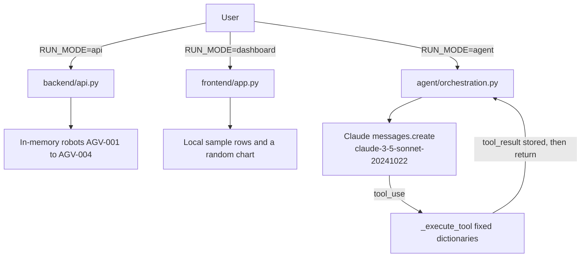

# RoboticsOps: Claude tool-calling agent for a simulated warehouse fleet (prototype)

[](https://github.com/AhadHashmani/RoboticsOps/actions/workflows/pytest.yml)

A prototype with three separate programs: a Claude tool-calling loop, a FastAPI app, and a Streamlit dashboard. Each one holds its own sample fleet. They do not share state.

Checked on Python 3.12. The commands in [Run](#run) were executed in that environment.

## What's real

**Claude tool calls.** `RoboticsAgent` in `agent/orchestration.py` calls `messages.create` with model id `claude-3-5-sonnet-20241022` and these four tools:

| Tool | Required input | What the handler returns |
| --- | --- | --- |
| `query_robot_status` | `robot_id` | Echoes the id, plus fixed `status`, `position`, `battery`, `current_task`, and `task_progress` |
| `assign_task_to_robot` | `robot_id`, `task` | `success: true` and a fixed completion string. Nothing is stored |
| `get_warehouse_layout` | none | A fixed 100m x 50m layout, four robot positions, and `stations: 12` |
| `predict_completion_time` | `robot_id`, `task` | `estimated_minutes: 3` |

`priority` on `assign_task_to_robot` is optional and limited to `low`, `medium`, or `high`. The handler ignores it.

After a `tool_use` block the agent appends the tool result to the conversation and returns. It does not send that result back to Claude in the same turn.

`agent/tools.py` defines a different schema (`get_warehouse_metrics`, `optimize_task_allocation`, and an `assign_task_to_robot` that requires `task_type` and `location`). Nothing imports that module.

**FastAPI.** `create_app()` in `backend/api.py` keeps an in-memory dict of four robots:

| Id | Status | Battery | Position |
| --- | --- | --- | --- |
| AGV-001 | active | 85 | (45.2, 23.5) |
| AGV-002 | active | 92 | (20.0, 15.0) |
| AGV-003 | idle | 78 | (75.5, 40.0) |
| AGV-004 | charging | 45 | (30.0, 35.0) |

Endpoints:

- `GET /`
- `GET /robots`
- `GET /robots/{robot_id}` (404 when the id is missing)
- `POST /robots/{robot_id}/assign`
- `GET /warehouse/metrics`
- `GET /health`
- `GET /docs` (generated OpenAPI UI)

`active_robots` on `/warehouse/metrics` is the count of robots whose status is `active`. `pending_tasks`, `completed_tasks`, and `efficiency` are constants in the handler. `POST /robots/{robot_id}/assign` returns `{"success": true, ...}` and leaves the robot record unchanged, including `current_task`.

**Streamlit dashboard.** `frontend/app.py` has five views: Overview, Robots, Tasks, Analytics, and AI Agent. The robot table is a local list of AGV-001 through AGV-004. The plot positions are `45 + 10*i` and `25 + 5*i`, not the API coordinates. Tasks are three local rows (T-001, T-002, T-003). Analytics draws a new random series on each rerun. The AI Agent view shows a text box and does not call Claude.

**Config defaults.** `ConfigManager` in `config/__init__.py` returns AGV-001..AGV-004 and a 100 by 50 warehouse with Station-1 through Station-12 when its yaml and json files are absent. The API, the agent, and the dashboard do not call `get_config()`.

`graphics/` is a placeholder. It does not render anything.

## Architecture



## Run

```bash
python3 -m venv .venv
source .venv/bin/activate
pip install -r requirements.txt
cp .env.example .env
```

`.env.example` sets `RUN_MODE=api` and leaves `ANTHROPIC_API_KEY` empty. The API and the dashboard do not read the key. Agent mode does, through the Anthropic SDK.

API, then open http://localhost:8000/docs :

```bash
RUN_MODE=api python main.py
```

Dashboard, then open http://localhost:8501 :

```bash
RUN_MODE=dashboard python main.py
```

The same dashboard also starts with:

```bash
python -m streamlit run frontend/app.py --server.headless true --server.port 8501 --browser.gatherUsageStats false
```

Agent mode. Put a key in `.env` first. With `ANTHROPIC_API_KEY` unset, the process prints the startup banner and then raises `TypeError` from the Anthropic SDK (`Could not resolve authentication method`) before it reads a command. This check did not complete a live Claude reply, so the configured model id has not been confirmed against the API.

```bash
RUN_MODE=agent python main.py
```

`requirements.txt` pins `pyarrow==17.0.0` because Streamlit imports PyArrow, and PyArrow 26 requires NumPy 2 while this file pins NumPy 1.26.4. `httpx` is pinned because FastAPI's `TestClient` imports it.

`docker/Dockerfile` uses `python:3.11-slim` and runs `python main.py`. `docker/docker-compose.yml` declares `api`, `dashboard`, `agent`, and `postgres`. Docker was not installed where these commands were checked, so `docker compose up` is not a verified run path. The app does not open a database connection. The compose `postgres` service and `DB_HOST` are unused by the Python code.

## Tests

`pytest -q` runs without `ANTHROPIC_API_KEY`. The GitHub Action [`.github/workflows/pytest.yml`](.github/workflows/pytest.yml) installs `requirements.txt` on Python 3.12 and runs that command. No secret is set.

`tests/test_agent.py` builds `RoboticsAgent` and checks the four tool names. It calls `_execute_tool` for each tool and for an unknown name. It does not call Claude.

`tests/test_integration.py` uses FastAPI's `TestClient` against `create_app()`: `GET /` returns 200, `GET /robots` returns a non-empty list, `GET /robots/AGV-001` returns that id, `GET /robots/NONEXISTENT` returns 404, `GET /warehouse/metrics` includes `total_robots` and `efficiency`, and `GET /health` returns `{"status": "healthy"}`.

`tests/test_robots.py` builds a `Robot` for AGV-001 and expects a validation error when `battery` is the string `"not_a_number"`.

## Limitations

- Simulated state only. Tool handlers, the API dict, and the dashboard lists are separate sample data.
- No Isaac Sim or NVIDIA Omniverse integration. Those packages are not imported.
- No production database. Robot state is a dict created inside `create_app()`.
- No live robots.

## Next steps

- Use one fleet object for the tool handlers, the API, and the dashboard, and make `POST /robots/{id}/assign` update that object.
- After a tool result, call Claude again and compare the reply with the resulting state.
- Keep a single tool schema. `agent/tools.py` and `RoboticsAgent._define_tools` currently disagree.
- Confirm `claude-3-5-sonnet-20241022` against the current Anthropic API before treating agent mode as working.
- Remove the unused Postgres service, or connect the API to it on purpose.

## Layout

```
main.py                      RUN_MODE=api, dashboard, or agent
agent/orchestration.py       Claude tool loop
agent/tools.py               unused second tool schema
backend/api.py               FastAPI app and the in-memory fleet
frontend/app.py              Streamlit dashboard
config/__init__.py           ConfigManager defaults
graphics/__init__.py         placeholder, no renderer
docker/Dockerfile
docker/docker-compose.yml
tests/                       pytest, no API key required
```

MIT license. See `LICENSE`.
